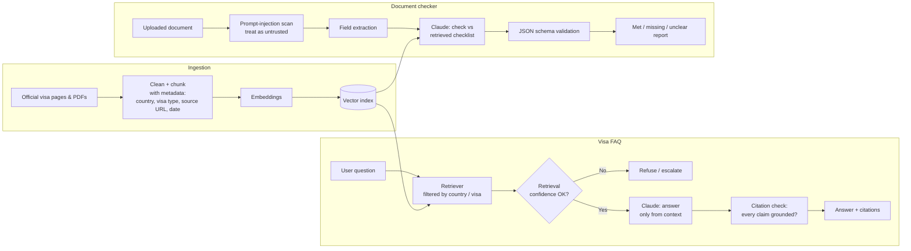

# RelocateRAG

**A RAG assistant for visa questions and document checks, for people planning to move abroad.**

> 🚧 **Status: in progress.** This repo currently holds the design, architecture and build plan. Code is being added in phases. See the [Roadmap](#roadmap) for what is done and what is next. Nothing below is a measured result yet. The evaluation section describes what *will* be measured.

---

## The problem

People planning a move abroad rely on scattered, fast-changing information: government visa pages, forum posts, agent advice. Generic chatbots make this worse. They answer confidently from stale training data, mix up countries and visa types, and rarely say where an answer came from.

Two questions come up again and again:

1. **"What do I need for this visa?"** Eligibility, documents, fees, processing steps.
2. **"Are my documents good enough?"** Does an offer letter, bank statement or degree certificate meet the checklist?

RelocateRAG answers both **only from curated official sources**, shows its sources, and says "I don't know" instead of guessing.

---

## What it does (planned)

### 1. Visa FAQ (Phase 1)
- Answers questions using retrieval over a curated set of official visa pages and guidance documents.
- Every answer includes **citations to the exact passages** it used.
- Refuses or escalates when retrieval confidence is low, or when the question is outside the indexed countries and visa types.

### 2. Document checker (Phase 2)
- User uploads a document (offer letter, bank statement, degree certificate).
- The assistant extracts the relevant fields and checks them against the selected visa's checklist.
- Returns a **schema-validated structured report**: each checklist item marked *met*, *missing* or *unclear*, with the evidence it found and a citation to the rule it checked against.

**Initial scope:** a small set of countries and visa types, to keep the source set curated and the evaluation honest. Coverage will expand only after the eval numbers hold up.

---

## Architecture



---

## Tech stack

| Layer | Choice |
|---|---|
| Language | Python |
| RAG framework | LlamaIndex |
| LLM | Anthropic Claude (Sonnet for answers, Haiku to be compared for cost) |
| Embeddings + vector search | LlamaIndex embedding integrations with a local vector store |
| Structured outputs | JSON schema validation (Pydantic) |
| Testing & CI | pytest, GitHub Actions |
| UI | Streamlit |

---

## Guardrails (carried over from RecoAgent)

This project reuses the guardrail pattern I built in [RecoAgent](https://github.com/Anudeepsyamprasad/recoagent):

- **Grounding rule:** the model may not state a fact (fee, deadline, requirement) that does not appear in the retrieved context.
- **Low-confidence refusal:** if retrieval scores fall below a threshold, the assistant says it doesn't know and points to the official source.
- **Untrusted input:** uploaded documents and scraped pages are treated as data, never as instructions, and scanned for prompt injection.
- **Not legal advice:** answers carry a clear note to confirm with the official authority. The assistant never claims a user *will* get a visa.
- **Audit log:** every retrieval, LLM call and decision is logged for review.

---

## Evaluation plan

A held-out question set (kept separate from development questions) will measure:

| Metric | What it checks |
|---|---|
| Retrieval hit rate | Did the right passage appear in the top-k results? |
| Groundedness | Is every claim in the answer supported by a cited passage? |
| Hallucination rate | Share of answers containing an unsupported claim |
| Refusal correctness | Does it refuse out-of-scope questions, and answer in-scope ones? |
| Checklist accuracy | Phase 2: are met/missing/unclear labels correct on sample documents? |
| Cost & latency per query | Sonnet vs Haiku comparison |

Model responses will be recorded and replayed (keyed by request hash), so tests and CI stay deterministic and free to run. Results will be published here once measured.

---

## Roadmap

- [x] Problem definition, scope and architecture
- [x] Guardrail and evaluation design
- [ ] **Phase 1:** source ingestion and chunking with metadata
- [ ] **Phase 1:** retrieval + cited answers + low-confidence refusal
- [ ] **Phase 1:** eval harness and held-out question set
- [ ] **Phase 1:** Streamlit demo
- [ ] **Phase 2:** document upload, extraction and checklist check
- [ ] **Phase 2:** checklist-accuracy evals
- [ ] Sonnet vs Haiku cost/quality comparison

---

## Planned repo structure

```
relocaterag/
├── data/
│   └── sources.yaml        # curated list of official source URLs + metadata
├── ingest/                 # fetch, clean, chunk, embed
├── rag/                    # retriever, answer chain, citation check
├── checker/                # document extraction + checklist logic
├── guardrails/             # grounding, refusal, injection scan
├── evals/                  # question sets, metrics, replay cache
├── app.py                  # Streamlit UI
└── tests/
```

---

## Known limitations

- Visa rules change often. Answers are only as current as the last ingestion date, which will be shown with each answer.
- Initial coverage is intentionally narrow.
- This is a portfolio project, not a substitute for official guidance or an immigration professional.

---

## Author

**Anudeep Syamprasad R**: [LinkedIn](https://www.linkedin.com/in/anudeepsyamprasad/) · [GitHub](https://github.com/Anudeepsyamprasad)
